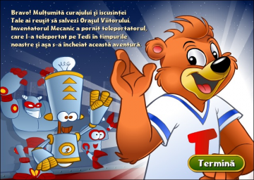

# Tedi_si_Vehiculul_timpului_reversed
A walkthrough of my experience of trying to understand how does the romanian game "Tedi si Vehiculul timpului" works.

    

---

### Why?

Just because one could do it. This kind of proves that almost 0 knowledge on a specific topic, can lead you somewhere if you know how to search for things. 

Also, this research went for about 5 hours, so not really a lot of time spent.

---

### Reading order:

- [01_first_contact.md](./documentation/01_first_contact.md)  
    First things related to the executable found in the archive
- [02_converting_running.md](./documentation/02_converting_running.md)  
    Converting the `.dcr` files in `.dir` ones and running them
- [03_extracting_assets.md](./documentation/03_extracting_assets.md)  
    Extracting the assets from the game
- [04_messing_things_up.md](./documentation/04_messing_things_up.md)  
    Extracting the `.w3d` files, modifying them and reassembling the whole thing back together  

---

### How did the idea came up and where did I found the game?

When doing a game project in unity, it seemed like the graphics present there were very similar to a game i used to play in the past.
I've searched for keywords like "Tedi game" and found the game from my childhood.

Now, the first place where i found it was from [myabandonware](https://www.myabandonware.com/game/tedi-si-vehiculul-timpului-gd9) , where the comments were saying that it contained a trojan. So i got sceptical and started to search for another source and then try to find as much informations as i could in a static manner.

The place where i found the executable:
https://archive.org/download/tedi-si-vehiculul-timpului

