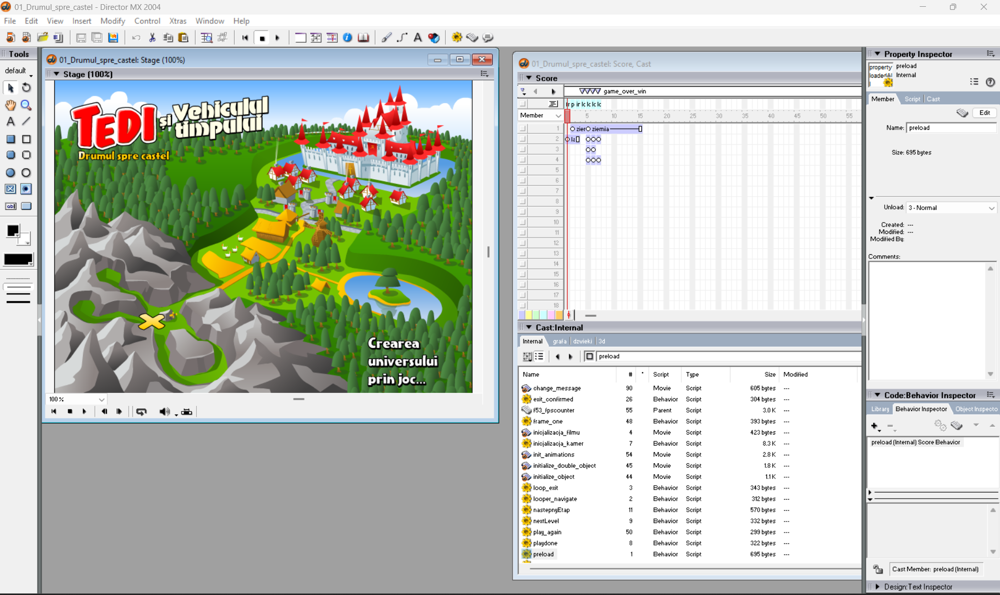
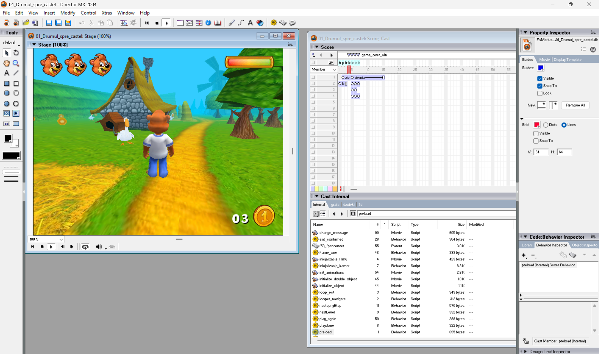

# 02_converting_running


I found the `.dcr` files and i wanted to know what is hidding behind them.

> Macromedia (later Adobe) Director uses two main file types: 
> 
> .DIR (Director Movie): The raw, editable project file containing all the source assets, timelines, and scripts.
>
> .DCR (Director Compressed Resource): The "Shockwave" published format. This is a protected, heavily compressed version designed for web playback and distribution. It strips out the authoring metadata to prevent people from stealing the game's assets.
>
> To get the original images (called "Cast Members" in Director terminology), you need to decompile the .dcr file and then load it into an older version of the authoring software.
>
> ProjectorRays is an open-source community tool designed specifically to reverse-engineer old Director formats. Download the latest ProjectorRays.exe release from its GitHub repository.
>
> Ai response


Searching for [ProjectorRays](https://github.com/ProjectorRays/ProjectorRays) on github

Getting the executable from the release showed a basic windows warning virus pop-up (which i've omitted). I then ran it in the CMD and tried the command 

```bash
...\RevTools\DCR_TO_DIR>projectorrays-0.2.0.exe decompile 01_Drumul_spre_castel.dcr
Decompiled Macromedia Director 8.5.1#104 movie 01_Drumul_spre_castel.dcr to 01_Drumul_spre_castel.dir
```
Which got me the `.dir` file.


Then i wanted to know what i can do with this "raw, editable project file". So i tried the following apps:
- LibreShockwave Asset Extractor
- Director MX 2004

### LibreSchockwave

Following the github page for the LibreShockwave https://github.com/LibreShockwave/LibreShockwave , let me to the `Debugger Build 20260810-034731` application. This created by default a `HKEY_CURRENT_USER` file under my `F:\` directory, `F:\HKEY_CURRENT_USER\Software\LibreShockwave\debugger-defaults.ini`.
Also, i didn't understand very fast how to use this debugger, so i didn't stay much longer on it (i'll try to come back to it).


### Director MX 2004

Searching for this on google led me to this archive.org page: https://archive.org/details/macromediadirect0000scha , which is a 611 pages book about how does the app works, so no application.

More reasearch and i've stumbled upon [this](https://www.reddit.com/r/abandonware/comments/1jvhy4k/trying_to_run_macromedia_director_mx_2004_on/) reddit post which had [this](https://archive.org/details/DirectorMX) link, also from archive.org.

Installing the software led me to a license page, which made me want to find license keys.

When searching for the availability of Macromedia Director today i found:

```
No, Macromedia Director is no longer officially sold by Adobe, which discontinued Adobe Director 12 on February 1, 2017
```

And then i went back to the reddit post and found the sole [comment](https://www.reddit.com/r/abandonware/comments/1jvhy4k/comment/mmb4wf0/?utm_source=share&utm_medium=web3x&utm_name=web3xcss&utm_term=1&utm_content=share_button) which covers how to get through all.


## Continuing

Now, when putting the `.dir` file onto the application:

<p align="center">
    
</p>


After that, when clicking on the play button in the top menu, started the whole game, to my surprise.

<p align="center">
    
</p>


Clicking on all of the elements in the bottom right, revealed a lot of functions, polish words and code (in i think is Lingo programming language)


