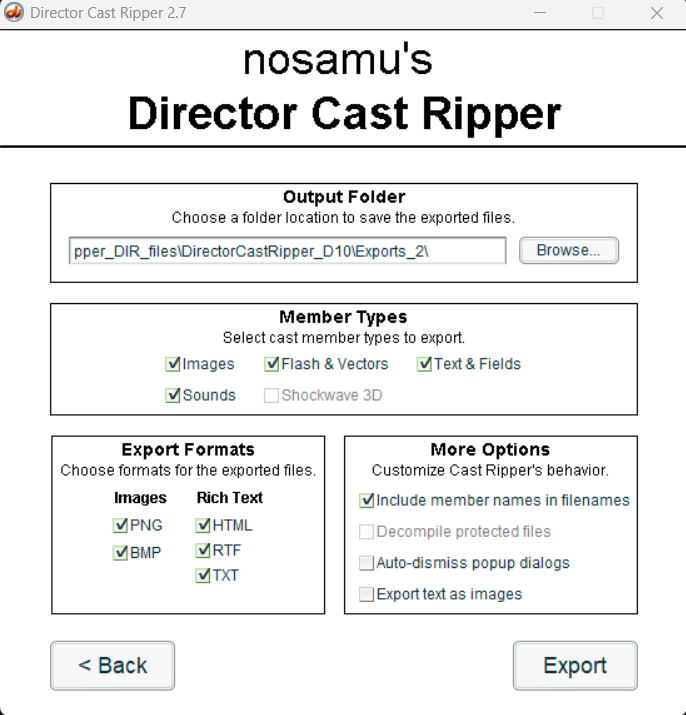

# 03_extracting_assets

After being able to run the game in a development interface, i am curious if i can scrape all the assets in a raw format.

Ai recommands `Director Cast Ripper` by n0samu.

(which i could also have found by searching on google `raw extraction assets macromedia Director Movie files`)

https://github.com/n0samu/DirectorCastRipper

> Two variants are offered: one built with Director MX 2004 (10) and one built with Director 12. 

(if, somehow, you follow this, take in mind that i needed the 12 version later on)

    

After extracting the first `.dir` file `01_Drumul_spre_castel.dir`, showed a lot of files with different extensions, like:
- ls
- wav
- csv
- png
- swf

The `wav`s and `png`s were exactly what i found they would be, the raw 2d images that appeared in the game, but now i'm curious about the other files (also if i would have also extracted the `bmp` `rtf` and `txt` files)

Now i've also selected `bmp` `rtf` `txt` and `include member names in filenames`

The files have names like: `dzwieki_5_sound_maly_atak.wav` , `dzwieki` meaning sound.

Good :+1:

