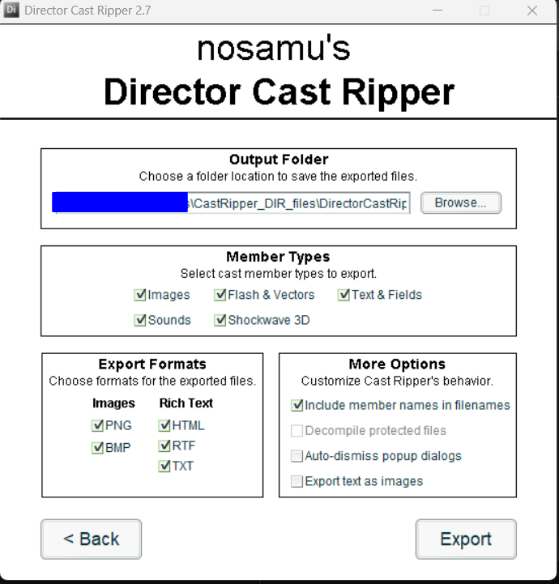
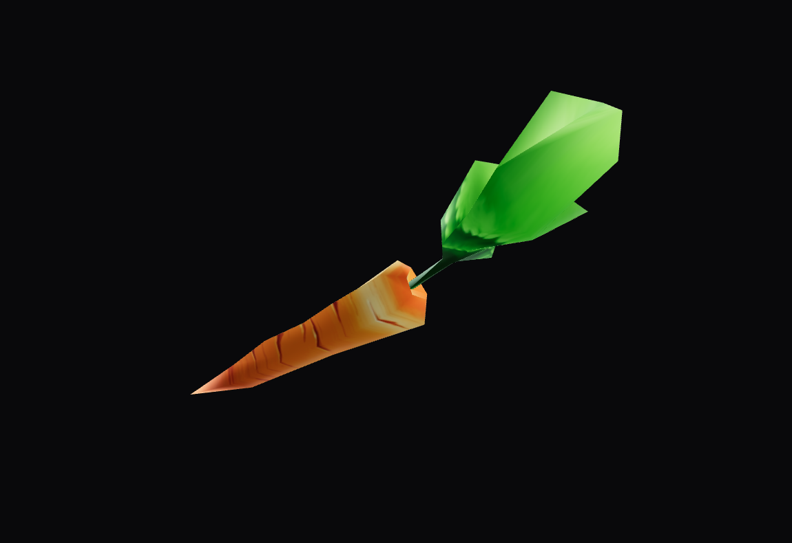

# 04_messing_things_up


After also having all the assets, would there be an easy way to modify the game contents and play it?

For example, instead of having Tedi running, to have another entity.

I think that would require a lot more work than just installing open source (or obsolete) software and bin bash bosh.


Asking some AI for guides in this directions, gave me some instructions.

But in my opinion, i think i could find the steps even without the AI part, but this will perhaps take a bit more time

Searching from `.dir` files to 3d objects

Which also showed me the [DirectorCastRipper](https://github.com/n0samu/DirectorCastRipper) github page
```
Member Types 	| File formats
-----------------------------
Bitmap, Picture 	PNG, BMP
Sound 	            WAV
Flash, Vector shape 	SWF
Shockwave 3D 	    W3D
Text 	            HTML, RTF, TXT
Field 	            TXT
```

So i have to find `W3D` files in the extract. 

But looking back to the CastRipper, i see that Shockwave 3D is disabled and i have to get the D12 version instead of the D10.

<p align="center">
    
</p>

Great, now i see the `.w3d` files, like: `3d_1_czarodziej_ambient1.w3d`


Searching for `w3d to obj`, popped up this github repository https://github.com/tomysshadow/Shockwave-3D-World-Converter

I hope this won't be a problem in the future:
> 	Cannot currently export Bones.

I tried on the first one `3d_1_czarodziej_ambient1.w3d`, but i got a 2 files:
- 3d_1_czarodziej_ambient1.MTL 0kb
- 3d_1_czarodziej_ambient1.obj 1kb 
    ```
    c_interp on
    d_interp on
    mtllib 3d_1_czarodziej_ambient1.MTL
    ```

Let's get one that's a bit bigger
like `3d_19_marchew.w3d` (carrot) 

Which now generated 3 files:
- 03-Default.TIFF 112kb
- 3d_19_marchew.MTL 1kb
- 3d_19_marchew.obj 15kb

I guess this is the `.obj` file format

```bash
└─$ cat 3d_19_marchew.obj
c_interp on
d_interp on
mtllib 3d_19_marchew.MTL
g Group01
usemtl 03-Default
v -70.310043 -0.787613 -4.427017
v -81.677040 -4.076596 -58.666939
v -83.493637 2.396100 -39.154774
v -87.620621 -0.741374 -70.199295
v -90.117233 -0.195359 -54.092621
v -81.677040 -4.076596 -58.666939
```

and the `.MTL`

```bash
└─$ cat 3d_19_marchew.MTL
newmtl 03-Default
Ka 0.882353 0.882353 0.882353
Ks 0.000000 0.000000 0.000000
Ns 12.799999
map_Kd 03-Default.TIFF
d 1.000000
```

Plugging it onto an online viewer (or in blender)

<p align="center">
    
</p>


